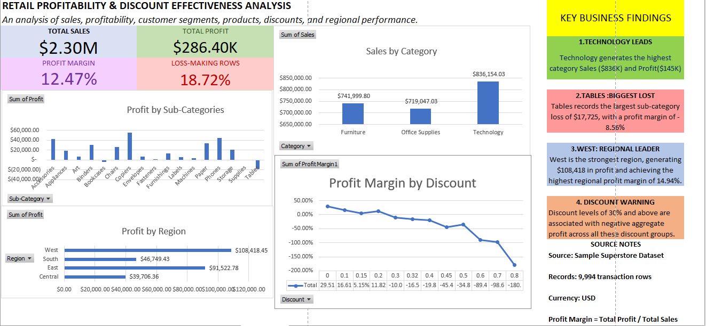
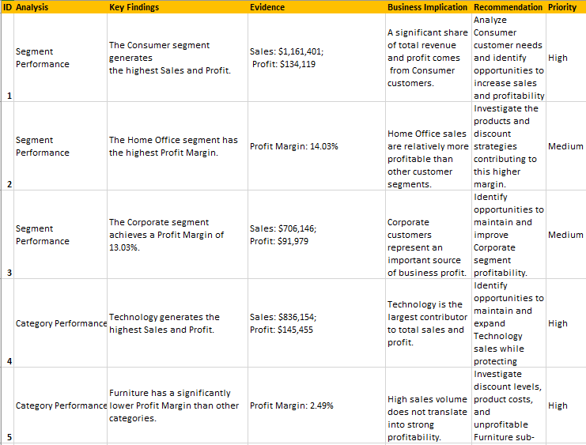
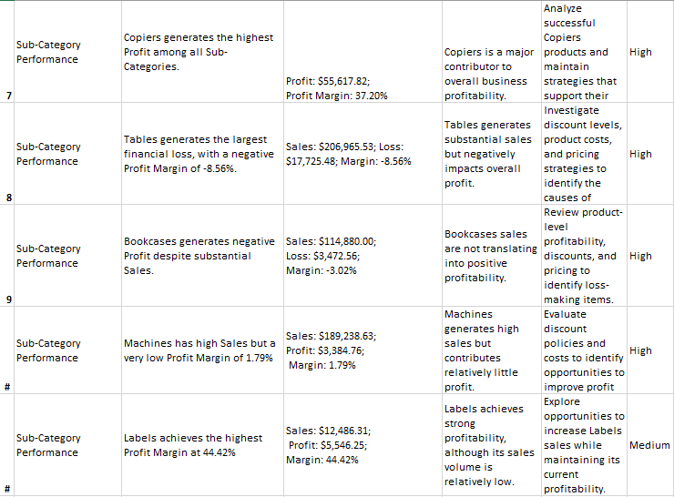
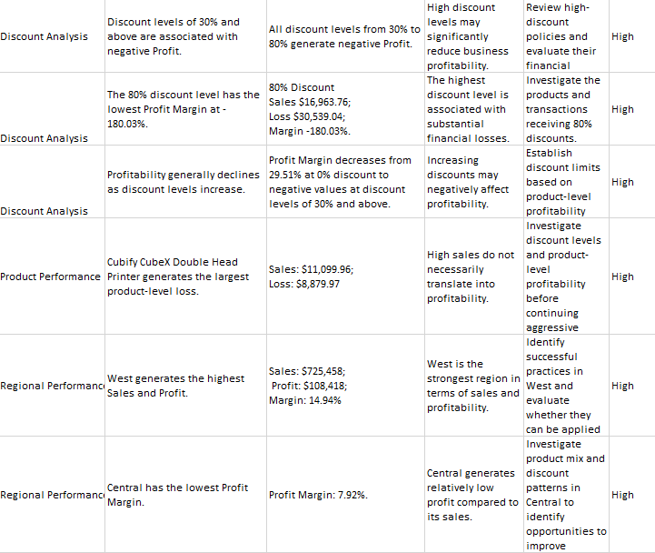

# Retail Profitability & Discount Effectiveness Analysis

An Excel-based data analytics project that examines sales, profit and discount patterns in the Sample Superstore dataset
and turns them into business insights and recommendations.

## Project Overview

The goal of this project was not only to calculate numbers, but to understand what drives profitability in a retail business
and to turn the data into practical business recommendations. The analysis focuses on sales, profit and profit margin
across product categories and customer segments, and on how discounts relate to profitability.

## Dataset

- **Dataset:** Sample Superstore
- **Size:** 9,994 rows and 21 columns (each row is one order record)
- **Source:** [Kaggle – Superstore Dataset](https://www.kaggle.com/datasets/vivek468/superstore-dataset-final)
- **License:** [- **License:** "Other" (terms specified in the dataset description on Kaggle). The raw dataset is not redistributed in this repository; please download it from the Kaggle link above.]

## Tools Used

- Microsoft Excel 2019
- Pivot Tables
- Pivot Charts

## Project Workflow

1. Imported the raw dataset into Excel
2. Explored the dataset structure and columns
3. Performed a data quality check
4. Cleaned the data
5. Conducted a data quality audit
6. Built Pivot Tables
7. Analyzed Sales, Profit and Profit Margin
8. Analyzed performance by Category, Sub-Category and Segment
9. Studied the relationship between discounts and profitability
10. Built a dashboard with Pivot Charts and KPI cards
11. Prepared 18 business insights with recommendations

## Dashboard

The dashboard contains KPI cards and 4 charts, all linked to Pivot Tables, so the charts update when the Pivot Table data changes.



## Key Findings

1. 1,871 transaction rows recorded negative profit.
2. Transactions with discounts above 30% generated negative total profit.
3. Technology was the most profitable category, while Tables recorded the largest loss.

## Business Insights

I prepared 18 business insights. Each insight includes: ID, Analysis, Key Findings, Evidence, Business Implication, Recommendation and Priority.

- Full document: [Business_Insights.pdf](Documentation/Business_Insights.pdf)





## Repository Structure

```text
superstore-retail-analysis/
├── README.md
├── Excel/
├── Dashboard_Screenshots/
│   ├── dashboard.png
│   ├── insight_1.png
│   ├── insight_2.png
│   └── insight_3.png
└── Documentation/
    └── Business_Insights.pdf
```

## About Me

I am a Business Administration student building a portfolio as a business-oriented Data Analyst. 
SQL, Python and Power BI projects are planned and will be added as separate repositories.
